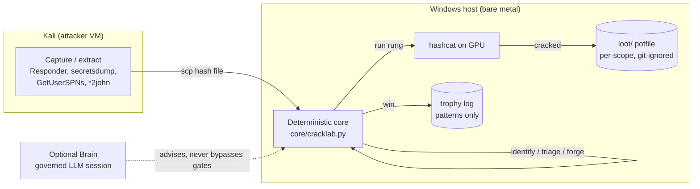

# password-audit-lab (CrackLab)

A GPU password-auditing rig I built in August 2026 to practise credential auditing
for the CPTS path and authorized lab work. Kali captures and extracts hashes; a
native-Windows machine runs hashcat on the GPU; a deterministic Python core drives
the whole thing with governance built in (authorized scope required, a wall-clock
cap, brute force gated behind an explicit flag).

I am publishing this to show how I design a tool: the architecture decision, the
governance that keeps it from being misused, and a tested, dependency-free core.

> Authorized use only: labs and engagements with written permission. See the
> "Authorized use" section below. This is a training tool, not a service.

## What it is

Three parts that each do one job:

- **Kali (capture + extract).** Responder, secretsdump, GetUserSPNs, the `*2john`
  extractors. Produces hashcat-format hash files.
- **Windows + hashcat (crack).** The GPU is only fast when hashcat talks to it
  natively. A VM cannot reach the card at full speed without PCI passthrough, which
  would take the GPU away from the host. So the cracking host is bare-metal Windows,
  reached over SSH.
- **Deterministic core (`core/cracklab.py`).** Identifies the hash, forges targeted
  wordlists, climbs a cost-ordered escalation ladder within a time cap, writes a
  trophy log, and produces a reporting appendix. Runs headless with no LLM and no
  internet. An optional "Brain" (a governed Claude Code session, swappable for a
  local model later) can drive it in plain English, but every capability also runs
  by hand.

## Architecture



The core and the GPU engine are separable on purpose: the ladder logic, hash
identification, triage and reporting are pure Python I can test without a GPU
(see `tests/`), while hashcat is an interchangeable execution backend.

## Benchmarks (the real numbers)

Measured on an RTX 3080 **Laptop** GPU, 8 GB, 94 W. Not the desktop card. Re-run
with `powershell -File scripts/benchmark.ps1`.

| hashcat mode | Hash | Speed | rockyou (14M) |
|---|---|---|---|
| 1000 | NTLM | 57 GH/s | instant |
| 0 | MD5 | 32 GH/s | instant |
| 1800 | sha512crypt | slow | minutes to hours |
| 5600 | NetNTLMv2 | 2.4 GH/s | instant |
| 13100 | Kerberos TGS-REP | 760 MH/s | under 1s |
| 18200 | Kerberos AS-REP | 762 MH/s | under 1s |
| 3200 | bcrypt | 59 kH/s | slow, by design |

The spread is the lesson: NTLM falls instantly, bcrypt and sha512crypt resist a
dictionary because they are deliberately slow. That is why the ladder trims the
slow modes down to the cheap rungs instead of brute forcing them.

## Governance (the point of the design)

This tool is built so it is hard to point at the wrong target or burn the GPU on
work that cannot pay off.

- **Scope is required.** Every `auto`/`manual` run needs `--scope htb|cpts|lab|engagement[:label]`.
  There is no default scope; you state the authorization every time.
- **Wall-clock cap.** 30 minutes by default (`--cap`). A run stops at the cap
  instead of grinding forever.
- **Brute force is gated.** PRINCE and mask attacks only run with
  `--allow-bruteforce`, passed explicitly. The ladder never reaches them on its own.
- **Triage before GPU.** `triage` labels machine accounts and `krbtgt` as
  abuse-only (pass-the-hash / golden-ticket material, effectively random, never
  worth cracking) and surfaces blank hashes and password reuse, so GPU time goes
  only where it can pay off.
- **Learning is governed** (see `docs/adr/0003`): self-mined rules are capped, need
  a minimum frequency of 2 (never learn from a single datum), log an audit trail,
  and engagement scopes learn into an isolated file that never touches the shared
  ruleset.
- **Per-scope isolation.** Potfiles and learned rules are kept separate by scope so
  engagement data never mixes with lab data.
- **GPU temp guard.** Each rung aborts if the laptop GPU passes a temperature limit.

## Escalation ladder

`auto` mode climbs cheapest-first and stops when everything is cracked or the cap
is hit: usernames + rules (password==username and cross-user reuse) -> targeted
wordlist -> rockyou -> rockyou+best64 -> self-mined learned rules -> larger rule
sets -> optional larger wordlists if fetched -> hybrid word+digits/specials (the
"Summer2024!" shape) -> cracked-feedback reuse hunt -> [PRINCE / mask, only with
`--allow-bruteforce`]. Every rung prints a keyspace ETA before it runs.

## Quick start

```
# 1) extract a hash on Kali, then copy it to the rig
scp hash.txt user@RIG_IP:CrackLab/hashes/

# 2) on the rig, identify and run the governed ladder
python core/cracklab.py identify hashes/hash.txt --provenance secretsdump
python core/cracklab.py auto hashes/hash.txt --scope htb --provenance secretsdump --cap 1800

# 3) read results
python core/cracklab.py status
python core/cracklab.py report hashes/ntds.txt --mode 1000 --username --context ad
```

By hand with the wrappers (no LLM, always works):

```
crack 1000 hashes\hash.txt                       # opinionated rockyou dict attack
hc -m 13100 -a 0 hashes\kerb.txt wordlists\rockyou.txt -r rules\OneRuleToRuleThemAll.rule
show 1000 hashes\hash.txt                         # print hash:plaintext pairs
```

Connecting over SSH, key setup, and the host hardening script are in
`docs/OPERATOR-PLAYBOOK.md` and `scripts/Harden-And-Setup-Admin.ps1`. Hostnames and
IPs there are placeholders (`RIG_IP`, `<user>`); fill in your own.

## Tests

The pure logic (identify, triage, forge, rulegen, analysis, HIBP scan) has a
pytest suite that runs without a GPU:

```
python -m pytest -q
```

26 tests, all passing on the published tree. The GPU-driven paths (hashcat
execution, benchmarking) are not unit-tested here; they depend on hardware.

## Authorized use

Only run this against hashes you are authorized to audit: your own lab targets,
your own training material, the CPTS exam, or an engagement with **written
permission** that covers credential auditing. Do not point it at anything else.
This repository ships no hashes, no wordlists, no cracked material, and no loot;
the `.gitignore` keeps them out permanently.

## What I learned

- An honest constraint beats a fake number. The slow-hash rows (bcrypt,
  sha512crypt) are the proof the rig is realistic, not the NTLM speed.
- Governance is a design feature, not paperwork. Required scope, a time cap, and a
  gated brute-force step make the tool safe to hand to an automated driver.
- Triage first. Labelling machine/`krbtgt` accounts as abuse-only saves GPU time
  and reflects how a real AD assessment actually treats those hashes.
- Keep the valuable logic pure. Separating the ladder and parsing from the GPU
  engine is what let me test it at all.

## Layout

`core/` deterministic Python core and sub-modules · `scripts/` Windows setup,
benchmark, and optional fetch helpers · `kali/` capture/decrypt helpers
(abuse-not-crack: DPAPI, GPP, LAPS) · `docs/` operator playbook, manual, ADRs ·
`brain/` backend config for the optional LLM driver · `*.cmd` Windows wrappers ·
`tests/` offline pytest suite.
